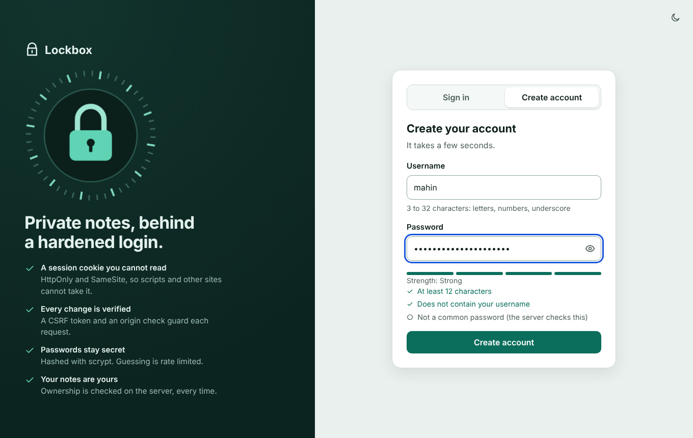
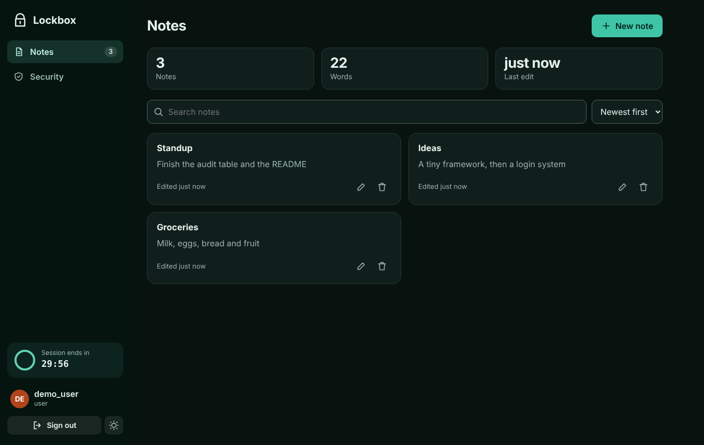
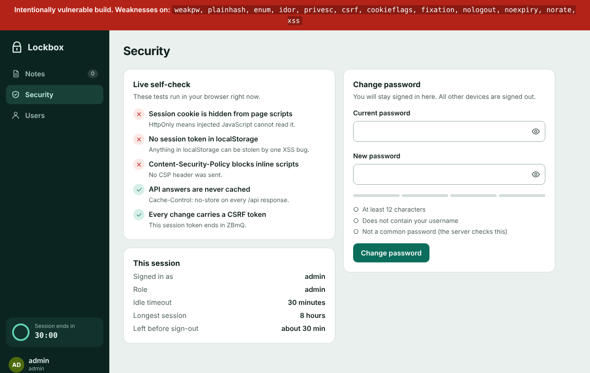

# Lockbox: an authentication system, attacked and fixed

Task 18 of the Varolline web developer internship: *Authentication and Authorization Audit*.

I built a small notes app with a session-based login (register, sign in, private notes, change password, admin page). Then I attacked it myself in 15 ways and fixed every hole. The attacks are code, so the whole audit can be re-run with one command.



## Run it

You need Node 20 or newer.

```bash
npm install
npm start                  # http://localhost:4000, secure build
npm test                   # 33 tests
npm run audit              # runs all 15 attacks before and after the fix, rewrites audit/RESULTS.md
```

On Windows PowerShell use `npm.cmd`. For another port: `$env:PORT=3000; npm.cmd start`.

The first start prints a random password for the `admin` account once. To choose your own, set `ADMIN_PASSWORD` before starting.

To see the weaknesses yourself, run the intentionally vulnerable build: `npm run start:vulnerable`. It shows a red banner and uses `data/db.vulnerable.json`. Never expose it to a network.

## The interface

- **Sign in / create account** with a combination-lock graphic that turns as you type and opens on success, a password strength meter, show/hide password, and a Caps Lock warning.
- **Notes**: search, sort, stats, create and edit in dialogs, delete with confirmation and an Undo toast.
- **Security center**: a live self-check that runs in your browser (is the cookie hidden from scripts, is there a token in localStorage, is the CSP active, is the API uncached, is a CSRF token held), plus a session countdown and the change-password form. On the vulnerable build the same page shows three red failures.
- **Users** (admins only): search, stats, and role changes behind a confirmation.
- Light and dark themes (follows your system, with a toggle), keyboard friendly, focus moves to the page title when you change page, reduced motion respected. axe-core found no violations in light or dark.

| Notes (dark) | Security center on the vulnerable build |
|---|---|
|  |  |

## How the system works

- **Server-side sessions**, not JWTs. After login the server stores a session record and sends a random 256-bit id in a cookie. Logout, password change and expiry just delete the record, so a stolen id can be killed. JWTs cannot be revoked easily without keeping a server-side list, which is a session store with extra steps. For a single web app, sessions are the simpler and safer choice.
- **Cookie**: `HttpOnly; SameSite=Strict`, plus `Secure` when `NODE_ENV=production`. Session ids are stored hashed (SHA-256) on the server.
- **CSRF**: every state-changing request needs an `X-CSRF-Token` header matching the session, and its `Origin` must match the host.
- **Passwords**: scrypt (N=16384) with a random 16-byte salt, compared in constant time.
- **Limits**: 5 failed logins per IP and username per 15 minutes, 50 per IP, 10 sign-ups per IP per hour.
- **Sessions end**: after 30 minutes idle, 8 hours total, on logout, and on password change (all other sessions).
- **Authorization**: `requireUser` and `requireAdmin` middleware. Notes are checked against their owner on every route.
- **Headers**: Content-Security-Policy (`script-src 'self'`), `X-Content-Type-Options`, `X-Frame-Options`, `Referrer-Policy`, `Cache-Control: no-store` on the API.

```
src/app.js        routes, sessions, CSRF, limits (and the switchable weaknesses)
src/passwords.js  scrypt, password policy
src/limiter.js    sliding-window failure counter
src/store.js      users, notes, sessions (JSON file for users and notes)
public/           the front end (plain JS, no inline styles, text is always inserted as text)
audit/            the 15 attacks, the runner, the results table
test/             every attack must work before and fail after
```

## How the audit works

Each weakness is a flag in `src/app.js` (for example `idor`, `csrf`, `fixation`). The normal build has none of them. For each attack the runner starts two fresh in-memory servers: one with that single flag on, one normal. The attack runs against both. "Exploited" means the attacker got what they wanted. The tests (`npm test`) fail if any attack does not work on the weak build or still works on the fixed one, so the fixes cannot quietly regress.

## Attacks tried and results

| # | Category | Attack | Before the fix | After the fix | Fix |
|---|---|---|---|---|---|
| A1 | Weak password rules | Register with weak passwords ("a", "123456", "password", username as password) | **Exploited**: 4 of 4 weak passwords accepted | **Blocked**: 0 of 4 weak passwords accepted | Server-side policy: 12 to 128 characters, common-password and pattern blocklist, no username inside. |
| A2 | Broken access control | Mass assignment: sign up with {"role":"admin"} and open the admin API | **Exploited**: register 201, GET /api/admin/users -> 200 | **Blocked**: register 201, GET /api/admin/users -> 403 | Registration ignores every field except username and password. Role is always "user". |
| A3 | Broken access control | Vertical escalation: normal user calls admin endpoints | **Exploited**: list -> 200, promote -> 200 | **Blocked**: list -> 403, promote -> 403 | requireAdmin middleware checks the role on every admin route. |
| A4 | Broken access control | IDOR: read, edit and delete another user’s note by guessing its id | **Exploited**: read 200, edit 200, delete 200; anonymous list -> 401 | **Blocked**: read 404, edit 404, delete 404; anonymous list -> 401 | Every note route checks note.ownerId === session user. Foreign notes answer 404. |
| A5 | Username enumeration | Login answers differently for unknown user vs wrong password | **Exploited**: existing: 401 "Wrong password" \| missing: 404 "No such user" | **Blocked**: existing: 401 "Invalid username or password" \| missing: 401 "Invalid username or password" | One message and one status (401 "Invalid username or password") for both cases. |
| A6 | Username enumeration | Timing: unknown usernames answer faster than real ones (no hash work) | **Exploited**: median existing 55 ms vs missing 2 ms | **Blocked**: median existing 48 ms vs missing 46 ms | Unknown usernames still run one scrypt verification against a dummy hash. |
| A7 | Username enumeration | Bulk probing of /api/register to list taken usernames (30 probes) | **Exploited**: 30 of 30 probes got a "taken" answer | **Blocked**: 10 of 30 probes got a "taken" answer | Sign-ups are rate limited per IP (10 per hour). A single probe still reveals one name; see README. |
| A8 | Missing CSRF protection | Forged cross-site POST using the victim’s cookie (Origin: evil.example, no token) | **Exploited**: evil origin -> 201, same origin without token -> 201, password change -> 400 | **Blocked**: evil origin -> 403, same origin without token -> 403, password change -> 403 | Origin check plus a per-session CSRF token in the X-CSRF-Token header; cookie is SameSite=Strict. |
| A9 | Insecure token storage | Session cookie flags and token exposure in the login response | **Exploited**: no HttpOnly, no SameSite, token in JSON body, Bearer token accepted | **Blocked**: HttpOnly + SameSite=Strict, no token in body | Cookie is HttpOnly, SameSite=Strict (and Secure in production). The token is never in the response body. |
| A10 | Insecure token storage | Session fixation: attacker plants a session id, victim logs in, attacker reuses it | **Exploited**: attacker GET /api/me with the planted id -> 200 | **Blocked**: attacker GET /api/me with the planted id -> 401 | A fresh random session id is issued at every login and any id sent by the client is ignored. |
| A11 | Insecure token storage | Stolen session id still works after the user logs out | **Exploited**: reused cookie after logout -> 200 | **Blocked**: reused cookie after logout -> 401 | Logout deletes the session on the server, so a copied cookie is dead. |
| A12 | Insecure token storage | Session never expires (idle for 2 hours, then 9 hours) | **Exploited**: after 2 h idle -> 200, after 9 h -> 200 | **Blocked**: after 2 h idle -> 401, after 9 h -> 401 | Idle timeout 30 minutes and absolute lifetime 8 hours, checked on every request. |
| A13 | Weak password rules | Online brute force: 40 wrong guesses against one account, then the right one | **Exploited**: no limit: 40 guesses answered, right password then -> 200 | **Blocked**: blocked with 429 at guess 6; right password during lockout -> 429 | Failed logins are counted per IP and username: 5 failures block that pair for 15 minutes (429). |
| A14 | Weak password rules | Stolen database: how fast can the stored password hashes be cracked? | **Exploited**: unsalted SHA-256 cracked to "sunshine2026!" in 0.0 ms | **Blocked**: stored as scrypt$16384$8$1$salt$hash (salted, slow) | scrypt (N=16384) with a random 16-byte salt per user, verified in constant time. |
| A15 | Insecure token storage | No Content-Security-Policy: injected script can read the token (XSS exposure) | **Exploited**: no Content-Security-Policy header | **Blocked**: CSP present: script-src 'self' (inline scripts blocked) | CSP blocks inline scripts, the UI renders notes as text, and the token lives in an HttpOnly cookie. |

## What I found and how I fixed it

**Weak password rules (A1, A13, A14).** The weak build accepted `a`, `123456` and the username as a password, allowed unlimited guesses, and stored unsalted SHA-256, which cracks instantly with a small word list. The fix is a server-side policy (12 or more characters, common-password and sequence blocklist, no username), a failure limiter that answers 429 with `Retry-After`, and scrypt with a per-user salt. The client shows the rules while typing, but only the server decides.

**Broken access control (A2, A3, A4).** Three separate flaws. Registration copied `role` from the request body (mass assignment), so anyone could sign up as admin. Admin routes only checked that someone was signed in. Note routes looked up by id and never asked who owned the note (IDOR). Fixes: whitelist the fields, check the role in middleware, and compare `note.ownerId` with the session user on every note route. A note that belongs to someone else answers 404, the same as a missing one, so ids cannot be probed.

**Username enumeration (A5, A6, A7).** The weak login said "No such user" with 404 for unknown names and "Wrong password" for known ones, and it skipped the hash work for unknown names, so response time gave the same answer (about 59 ms against 2 ms). The fix is one message, one status code, and a dummy scrypt run for unknown names (54 ms against 57 ms).

**Missing CSRF protection (A8).** With the cookie alone, a forged POST from `evil.example` created a note. The fix has three layers: the cookie is `SameSite=Strict`, the `Origin` header must match, and every change needs the per-session token. A request from another site cannot read that token.

**Insecure token storage (A9, A10, A11, A12, A15).** The weak build returned the session token in the login response, the front end kept it in `localStorage`, the cookie had no `HttpOnly` or `SameSite`, and the server also accepted the token as a Bearer header. I also tested session fixation (the id survived login), logout (the cookie was cleared but the session stayed valid), and expiry (a session was still valid 9 hours later). Fixes: `HttpOnly` cookie only, no token in any response, a fresh id at every login, server-side deletion on logout and password change, and idle and absolute timeouts.

The XSS part was checked in a real browser (`audit/browser-xss.cjs`, needs Playwright). A note containing `` was saved on both builds:

```
VULNERABLE  script ran: YES  loot: {"cookie":"sid=CZkU...","token":"CZkU..."}  attacker request with stolen token -> HTTP 200
FIXED       script ran: no   loot: (nothing)
```

On the weak build the injected script read the cookie and the `localStorage` token, and the attacker took over the account from another machine. On the fixed build the note is shown as plain text, the CSP would block an inline handler anyway, and the cookie is invisible to JavaScript.

## What is still not perfect

I would rather list these than pretend they are solved.

- **Sign-up still reveals taken usernames, one probe at a time.** Fixing that needs email verification ("check your inbox either way"), which this app does not have. The limiter stops bulk probing (10 per hour per IP) but not a patient attacker. A7 measures the bulk case only.
- **The limiter and the sessions live in memory.** A restart signs everyone out and resets the counters, and several server processes would not share them. A real deployment would use Redis or a database.
- **Rate limits are per IP.** Behind a reverse proxy every user shares the proxy's address unless you configure trusted forwarding. Per-username limiting also lets an attacker lock a victim out for 15 minutes (a deliberate trade-off against brute force).
- **No password reset, no MFA, no email verification, no breached-password check (such as Have I Been Pwned).** All would be next steps.
- **HTTPS is required in production.** Run with `NODE_ENV=production` so the cookie gets `Secure`, and put the app behind TLS. Over plain HTTP, anyone on the network can read the session cookie.
- **Not covered by this audit:** denial of service beyond the limiter, dependency vulnerabilities (`npm audit` is worth running), and anything outside this one app.
- The audit finds the flaws I thought to test. Passing 15 attacks is evidence, not proof.

## Licenses

MIT (see `LICENSE`). The front end uses only system fonts.
